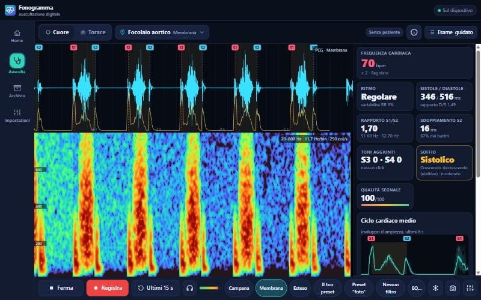

# Fonogramma

### Il tuo fonendoscopio diventa digitale.

Collega il fonendoscopio al jack del telefono o del PC: **vedi** il cuore e i polmoni in tempo reale,
**ascolti** in cuffia, **registri**, **rallenti** e **analizzi** i suoni.

 

**Nessuna registrazione · nessun account · nessuna pubblicità · niente da scaricare dagli store**

 

---

## 🚀 Inizia in 30 secondi

1. **Apri** 👉 **https://chopin94.github.io/fonogramma/**
2. **Installa** l'app (facoltativo, ma consigliato: si apre a schermo intero e funziona offline)
   - **Android / PC (Chrome, Edge):** menu ⋮ → **Installa app**, oppure il pulsante *Installa* nella Home
   - **iPhone / iPad (Safari):** pulsante Condividi → **Aggiungi a Home**
3. **Collega** il fonendoscopio, tocca **Ausculta** → **Avvia** e consenti l'uso del microfono.
4. La prima volta fai la **verifica dell'ingresso** (30 secondi): l'app controlla che il suono arrivi davvero dal fonendo e ti dice cosa correggere.

> 💡 **Non hai ancora il fonendoscopio collegato?** Provala subito con il **simulatore**:
> *Ausculta → **Sorgente** (o l’icona Regolazioni, i cursori in basso a destra) → Simulatore* e scegli un caso (soffi, galoppi,
> crepitii, sibili…).

---

## ✨ Cosa sa fare

<table>
<tr>
<td width="50%" valign="top">

### ❤️ Cuore
- **4 focolai + punto di Erb** su una mappa del torace, con posizione, campana o membrana e cosa ascoltare
- Tracciato con **S1, S2, S3, S4**, click e schiocchi riconosciuti in automatico
- **Frequenza cardiaca**, ritmo, sistole/diastole, sdoppiamento di S2
- **Soffi**: fase (sistolico/diastolico), forma, intensità e tonalità
- **Ciclo cardiaco medio** e qualità del segnale

</td>
<td width="50%" valign="top">

### 🫁 Torace
- **12 punti** anteriori e posteriori
- **Waterfall** (spettrogramma) fluidissimo, fino a 500 colonne al secondo
- **Frequenza respiratoria** e rapporto inspirazione/espirazione
- **Crepitii** fini e grossolani, **sibili** e **ronchi**
- Intensità del murmure e **confronto destra/sinistra**

</td>
</tr>
<tr>
<td valign="top">

### 🎧 Ascolto e registrazione
- **Ascolto in cuffia** con limitatore di protezione
- **Filtri** pronti (campana, membrana, polmone…) ed **equalizzatore** a 9 bande
- **Riduzione del rumore** adattiva
- **“Ultimi 15 s”**: salva quello che hai *appena* ascoltato
- Player con **loop**, **rallentatore** 0,5×–0,75× senza cambiare tono, zoom, esportazione **WAV/CSV**

</td>
<td valign="top">

### 📋 Visite e referti
- **Archivio pazienti** con anamnesi e parametri vitali
- **Esame guidato** punto per punto, con conto alla rovescia
- Reperti precompilati dall'analisi (Levine, forma, timbro, irradiazione…)
- **Referto stampabile / PDF**
- **Backup** su file da spostare fra i tuoi dispositivi

</td>
</tr>
<tr>
<td valign="top">

### 🎯 Suono pulito, guidato
- **Riconosce l'ingresso**: jack, USB, Bluetooth o microfono del telefono, e se il sistema altera il suono
- **Verifica guidata** in 3 passi: colpi sulla membrana, fonendo in aria, fonendo sul torace
- **Semaforo** sul tracciato con il rimedio: voce, sfregamento, urti, ronzio a 50 Hz, saturazione, battito poco chiaro
- I tratti disturbati vengono **segnati ed esclusi** dal conteggio dei crepitii

</td>
<td valign="top">

### 🏠 Registrazione a casa
- Profilo **Paziente**: ti guida punto per punto, con la posizione spiegata in parole semplici
- Registra **da sola** appena il suono è pulito e propone di **ripetere** i punti disturbati
- Alla fine **Invia al medico**: un file da mandare con WhatsApp o email, che il medico apre in Fonogramma
- Profili **Medico** e **Studente** per decidere quanta guida mostrare

</td>
</tr>
</table>

&nbsp;

---

## 🩺 Cosa ti serve

| | |
|---|---|
| **Fonendoscopio con uscita jack** | Un fonendoscopio elettronico o un microfono da fonendoscopio con cavo jack da 3,5 mm; va bene anche un microfono o una scheda audio **USB** |
| **Telefono o PC** | Chrome, Edge o Safari recenti. Funziona su Android, iPhone, Windows, macOS e Linux |
| **Adattatore (se serve)** | Se il telefono non ha il jack: adattatore **USB-C → jack con ingresso microfono**. Se il cavo ha 3 contatti (TRS) e il telefono vuole quello da 4 (TRRS), usa uno sdoppiatore cuffie/microfono |
| **Cuffie con filo** *(consigliate)* | Per ascoltare senza il fischio di ritorno dell'altoparlante. Le cuffie Bluetooth ritardano il suono e su alcuni telefoni (spesso iPhone) prendono il posto del microfono del fonendo |
| **Senza fonendo?** | Puoi appoggiare il **telefono sul torace** (bordo inferiore, pelle nuda): va bene per il cuore, meno per i polmoni. I fonendi **Bluetooth** funzionano solo se il telefono li vede come microfono, con qualità ridotta |

---

## 📖 Guida rapida

### 0 · La prima volta: verifica l'ingresso
*Impostazioni → Ingresso audio*: scegli **come acquisisci il suono** (fonendo con filo, telefono sul torace, fonendo
Bluetooth) e tocca **Verifica guidata dell'ingresso**. In 30 secondi: picchietta 3 volte la membrana, tienila ferma
in aria, poi appoggiala sul cuore. L'app ti dice se l'ingresso è adatto e cosa correggere.

### 1 · Auscultazione libera
1. **Ausculta** → scegli **Cuore** o **Torace** in alto.
2. Tocca il nome del **punto** (es. *Focolaio aortico*) per sceglierlo sulla mappa: il filtro giusto si imposta da solo.
3. **Avvia**. In alto vedi il tracciato, sotto il waterfall e a destra (o sotto, sul telefono) le misure.
4. Guarda il **semaforo** in alto a sinistra sul tracciato: verde vuol dire suono pulito; se è giallo o rosso dice
   il problema (voce, sfregamento, urti, ronzio…). Toccalo per il rimedio e i dettagli dell'ingresso.
5. **Registra** per salvare, oppure **Ultimi 15 s** per tenere quello che hai appena sentito.

### 2 · Visita completa
1. **Home → Nuova visita** e scegli o crea il paziente.
2. Compila anamnesi e parametri vitali.
3. **Esame guidato**: l'app ti porta punto per punto (cuore e torace), aspetta un suono pulito, registra e
   analizza ogni punto; se una registrazione è disturbata ti propone di ripeterla.
4. Controlla i reperti proposti, aggiungi le tue conclusioni e apri il **Referto** → *Stampa / PDF*.

### 3 · Riascoltare una registrazione
Apri una registrazione dall'**Archivio**: si sente e si vede **come durante l'auscultazione** (stesso filtro e
stessa riduzione del rumore). Puoi metterla in **loop** (tutta, una selezione o 1–3 cicli cardiaci),
**rallentarla**, cambiare filtro, fare zoom e leggere la tabella dei battiti e degli eventi. I tratti disturbati
sono in rosso. **WAV** scarica l'audio come lo ascolti; l'originale non filtrato è in *Altro*.

### 4 · Regolazioni utili
L’icona **Regolazioni** (i cursori in basso a destra) nella schermata di auscultazione apre sorgente (fonendoscopio, simulatore o file
WAV/MP3), guadagno, canale sinistro/destro, filtri, equalizzatore e dettaglio del waterfall. Nel simulatore ci
sono anche i **disturbi** (voce, sfregamento, ronzio, urti, stanza rumorosa) per vedere come reagisce il semaforo.

### 5 · Registrazione a casa per il medico
In *Impostazioni → Chi usa l'app* scegli **Paziente**: in Home compare **Registrazione per il medico**. Scrivi il
nome, scegli cuore e/o respiro e segui le istruzioni: per ogni punto l'app mostra dove appoggiare il fonendo,
registra da sola quando il suono è pulito e alla fine prepara il file da **inviare al medico**. Il medico lo apre
con *Impostazioni → Importa backup* e trova il paziente con la visita *Registrazione a domicilio*.

---

## 🔒 I tuoi dati restano tuoi

- Pazienti, visite e registrazioni sono salvati **solo nel browser del tuo dispositivo**.
- **Niente server, niente account, niente cookie di tracciamento, niente statistiche.** L'audio non lascia mai il telefono.
- Per conservare i dati o spostarli su un altro dispositivo usa **Impostazioni → Esporta backup** e poi **Importa backup** sull'altro.
- ⚠️ Se cancelli i dati del browser o disinstalli l'app, l'archivio sparisce: **fai un backup ogni tanto**. Il file contiene dati sanitari, quindi custodiscilo bene.
- Consiglio: in *Impostazioni → Archivio* tocca **Chiedi archiviazione persistente**, così il browser non libera spazio da solo.

---

## ❓ Problemi comuni

<b>Non sento nulla o il tracciato è piatto</b>

- Controlla in *Impostazioni → Ingresso audio* che sia scelto il dispositivo giusto (tocca *Mostra i nomi degli ingressi*).
- Molti cavi hanno il segnale su un solo lato: prova **Canale → Sinistro** o **Destro**.
- Sul telefono serve un ingresso **microfono** (TRRS o adattatore USB-C con microfono), non un'uscita cuffie normale.
- Alza il **guadagno** nelle regolazioni.
- Fai la **verifica guidata dell'ingresso**: se picchiettando la membrana non arriva nessun colpo, il suono non
  arriva dal fonendo e l'app ti dice perché.

<b>Il semaforo è giallo o rosso: cosa significa?</b>

- **Voce**: qualcuno parla; la voce può sembrare un soffio. Silenzio, e il paziente respiri senza parlare.
- **Sfregamento**: la membrana striscia su pelle, peli o vestiti e fa rumori simili ai crepitii. Pelle nuda, fonendo fermo, peli inumiditi.
- **Urti o movimenti**: tieni fermi fonendo e tubo, con pressione costante.
- **Ronzio a 50 Hz**: di solito il caricatore del telefono o il cavo vicino a una presa. Stacca il caricatore.
- **Il telefono taglia i silenzi**: è attiva la riduzione del rumore del sistema. Su iPhone: Centro di Controllo → *Modalità microfono* → *Standard*.
- **Battito poco chiaro / Respiro poco udibile**: premi meglio la membrana, sposta di poco il punto, riduci il rumore della stanza.

<b>Posso usare le cuffie Bluetooth?</b>

Per ascoltare sì, ma il suono arriva con un piccolo ritardo e su molti telefoni, collegandole, il telefono usa il
**loro microfono** al posto del fonendo: l'app se ne accorge e te lo segnala. Per auscultare meglio usa cuffie con
filo, oppure guarda il tracciato e riascolta dopo.

<b>Sento un fischio</b>

È il ritorno dall'altoparlante al microfono: usa le **cuffie** oppure disattiva l'ascolto (icona 🎧).

<b>Il browser non chiede il permesso del microfono</b>

Apri l'app dal link ufficiale **https://** e controlla nelle impostazioni del sito che il microfono non sia bloccato.

<b>Come aggiorno l'app?</b>

Si aggiorna da sola: quando esce una nuova versione compare l'avviso *Nuova versione disponibile → Aggiorna*.

<b>Funziona senza internet?</b>

Sì. Dopo la prima apertura l'app resta sul dispositivo e funziona anche offline.

---

> [!IMPORTANT]
> **Fonogramma è uno strumento didattico e di supporto all'auscultazione.** Le analisi automatiche
> sono indicative e non sostituiscono il giudizio clinico. **Non è un dispositivo medico certificato.**

---

Fatto con ❤️ in puro HTML, CSS e JavaScript: nessuna dipendenza, tutto gira nel tuo browser. 
Suggerimenti e segnalazioni sono benvenuti nelle [Issues](https://github.com/chopin94/fonogramma/issues).

**[▶ Apri Fonogramma](https://chopin94.github.io/fonogramma/)** · [Licenza MIT](LICENSE)

